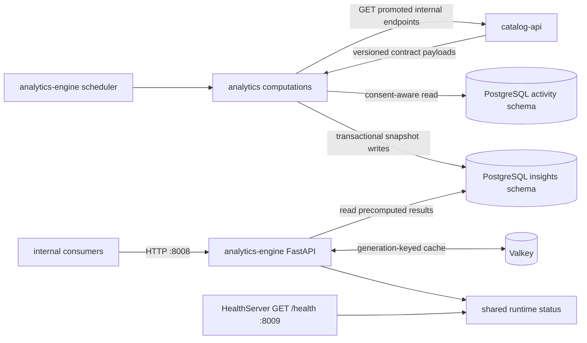

# Analytics-engine architecture

The analytics engine turns expensive catalog and graph queries into scheduled, read-optimized results. It communicates with `catalog-api` over a promoted internal HTTP contract and does not connect to Neo4j directly.

## Repository boundary

The promoted contract at [`contracts/catalog-api/internal-insights/v1/`](../contracts/catalog-api/internal-insights/v1/) fixes contract version `1.5.0`, the `catalog-api` producer repository and commit, the OpenAPI digest, and the generated Python binding digest. [`source.json`](../contracts/catalog-api/internal-insights/v1/source.json) is the provenance record; `just contract-check` verifies its digests and version against [`openapi.yaml`](../contracts/catalog-api/internal-insights/v1/openapi.yaml) and [`insights/catalog_api_contract.py`](../insights/catalog_api_contract.py). Database definitions remain in `database-schema`; shared connection and health primitives remain in `python-libraries`.

The promoted OpenAPI document is the authority for the producer transport. This table maps that boundary to the engine's stable computation keys and read model without duplicating request or response schemas:

| Computation key | `catalog-api` input path | Local effect | Read endpoint on `:8008` |
| --- | --- | --- | --- |
| `artist_centrality` | `/api/internal/insights/artist-centrality` | `insights.artist_centrality` | `/api/insights/top-artists` |
| `genre_trends` | `/api/internal/insights/genre-trends` | `insights.genre_trends` | `/api/insights/genre-trends` |
| `style_year_counts` | `/api/internal/insights/style-year-counts` | `insights.style_year_counts`, `insights.style_parents`, `insights.genre_year_counts` | None — read by `catalog-api` |
| `style_atlas` | `/api/internal/insights/style-year-counts`, once a month | `insights.genre_atlas_sectors`, `insights.style_atlas_layout` | `/api/insights/style-atlas` |
| `style_landmarks` | `/api/internal/insights/style-landmarks` | `insights.style_landmark_masters` | `/api/insights/style-atlas` (`masters`) |
| `style_cotags` | `/api/internal/insights/style-cotags` | `insights.style_cotags` | `/api/insights/style-atlas/cotags` |
| `label_longevity` | `/api/internal/insights/label-longevity` | `insights.label_longevity` | `/api/insights/label-longevity` |
| `anniversaries` | `/api/internal/insights/anniversaries` | `insights.monthly_anniversaries` | `/api/insights/this-month` |
| `data_completeness` | `/api/internal/insights/data-completeness` | `insights.data_completeness` | `/api/insights/data-completeness` |
| `community_enrichment` | `/api/internal/insights/community-enrichment` | Triggers the producer-owned bounded enrichment batch | No dedicated read endpoint |
| `release_rarity` | `/api/internal/insights/rarity-scores` | `insights.release_rarity` | `/api/insights/release-rarity` |
| `activity_summary` | None — reads `activity.events` and `activity.impressions` directly | `insights.activity_summary` | `/api/insights/activity-summary` |

`/api/insights/status` reads the latest `insights.computation_log` row for all twelve computation keys. `/health` is also available on the FastAPI port; the independently served readiness probe is `GET /health` on port 8009.

## Scheduled precomputation

The scheduler waits 30 seconds after startup, then runs artist centrality, genre trends, style year counts, the style atlas, style landmarks, style co-tags, label longevity, monthly anniversaries, data completeness, community enrichment, release rarity, and the activity summary sequentially. Each computation has an endpoint-specific HTTP read budget and records `completed` or `failed` in `insights.computation_log`. A failed computation does not prevent later computations from running. Non-empty result sets replace their corresponding rows transactionally; an empty producer result leaves the previous snapshot intact. Style year counts write three tables from one producer read, in one transaction: `insights.style_year_counts` (release and master counts per style and release year), `insights.style_parents`, and `insights.genre_year_counts` (release counts per genre and release year, which date each genre's emergence). The producer publishes raw genre shares with no floor; the engine keeps each genre at a share of at least 0.20 and marks exactly one dominant parent per style, the highest share with ties broken by genre name. A style with no genre at 0.20 has no parent row. A producer result missing any of the three parts is treated as empty. Style landmarks write `insights.style_landmark_masters` from one producer read, replacing the whole table in one transaction: the producer returns up to 25 masters per style, by release count descending then master id, and the engine stores each master's position within its style as `rank` (1 to 25), so a style over the cap keeps its first 25. The table's `title` is NOT NULL while the producer's can be null, so a master with no title is stored with an empty-string title rather than dropped or given display copy; the client words its absence. A null year stays NULL. Style co-tags write `insights.style_cotags` from one producer read, the same way: one transaction replaces the whole table, and the empty-result rule keeps the previous snapshot. The producer returns each style's top 25 other styles by shared release count, ties by name, with each pair listed under both of its styles and no style paired with itself. The engine stores each pair's position within its style as `rank` (1 to 25), keeping a style's first 25 if it ever exceeded the cap. The table's `style <> other` CHECK is left to fail loudly: a self pair fails the computation, which keeps the previous snapshot and records `failed`. The producer's 300 s processing budget is read under three times that, like the other long reads. Community enrichment is a producer-side operation and records its returned `enriched` count rather than writing a result table here. The activity summary is the one exception to the empty-result rule and rewrites its window either way, for the reason given below.

The next cycle begins one configured interval after the preceding cycle started (or immediately if a cycle outlasts the interval). Precomputation is deliberate: expensive graph aggregation occurs on a schedule, while read endpoints perform bounded PostgreSQL queries. This separates computation latency from request latency and gives operators a durable status record for each computation.

## Style lifecycle and the Genre Atlas layout

These compute concept B of Strata, the Genre Atlas. ADR 0016 section 4 in `design` records the decision. Design spike `gm-design-4804` (sections B1 to B5, and its Recommendation for B) holds the evidence. The rule and the layout are ported from that spike's harness.

**Lifecycle stages** ([`insights/style_lifecycle.py`](../insights/style_lifecycle.py)) are computed causally from release-year counts, so the stage in year *y* reads only years up to *y*. There are five stages: absent, emerging, established, reviving and declining. Every threshold is a field of `LifecycleRule`, and `LIFECYCLE_RULE.describe()` returns the rule as data, so the UI can show what a stage means. The defaults are the spike's:

- emergence is the year a style reaches 25 cumulative releases;
- a style is active at a 3-year trailing mean of at least 0.5 of its running peak;
- an active style is established 10 years after emergence;
- an inactive style is reviving at 1.5 times its trough and 0.25 of its peak.

The emergence year is this 25-release year, never graphinator's `first_year`. One mis-dated release sets `first_year`. The same emergence year dates the "emerges after its parent genre" rule, for genres as well as styles: a genre's emergence year is the year it reaches 25 cumulative releases in `insights.genre_year_counts`, found by the same `LifecycleRule`. Like the stages, genre emergence is derived on read and not stored.

The timeline ends at the last complete calendar year, and its latest two years are marked provisional, because catalogue entry lags release. The stages are not stored: the pinned schema has no stage table. A reader computes them from `insights.style_year_counts` with the same module, which takes milliseconds for every style and year (spike section B5). Because the stages are derived on read, they always match the stored counts.

**The layout** ([`insights/style_atlas.py`](../insights/style_atlas.py)) is the `style_atlas` computation. It runs right after `style_year_counts` and does real work once per month. A run in a month that already has `insights.genre_atlas_sectors` rows returns 0 before any producer read, so the month's map holds still for every reader. Otherwise it builds the layout as follows:

- **Inputs.** It reads the producer's style-year-counts response itself. The genre overlap and each style's lean need the raw shares under the 0.20 parent threshold, which `insights.style_parents` does not keep. Parents are reduced with the same rule as that table (share >= 0.20, one dominant), so the hulls match it. `graph.part_of` is never an input.
- **Genre ring.** Genres go on a ring in the exact maximum-weight cycle over their soft overlap. Each sector's width is proportional to the square root of its member count plus one.
- **Placement.** A style is drawn in its dominant parent's sector, and a ghost copy is drawn in every secondary parent's sector. A ghost counts as a member of its host's hull. Inside a sector, a node's angle is the rank of its lean toward the following ring neighbour, and its radius is the rank of its emergence year.
- **Measured alternative.** Co-tag MDS inside each sector was measured in the spike. It roughly halves edge crossings but moves p95 1.13 nearest-neighbour distances a month, over the 1.0 bar, so lean × emergence rank (p95 0.69) is used.
- **Pinning.** The latest earlier month's `insights.genre_atlas_sectors` rows pin the ring order and every sector's frame. A new genre is inserted where it adds the most overlap, and a vanished genre is dropped. The frames are reused unchanged while every square-root width stays within 10% of its pinned width. Otherwise all sectors are resized from the first ring genre's pinned start angle, so the ring does not rotate. That is why sector bounds may pass 2π.
- **Write.** Sectors go to `insights.genre_atlas_sectors`, and style and ghost nodes go to `insights.style_atlas_layout`. Both are written in one transaction under an advisory lock, with the month re-checked inside it, so a concurrent run cannot interleave a second layout. Every run logs its intrusions, omissions and p95 movement against the previous month.

The epic's bars are regression tests over two synthetic catalogue months (`tests/test_style_atlas_bars.py`):

- lifecycle flips of at most 2% between months;
- at most 10% flips under any single ±10% threshold change;
- zero hull intrusions and zero omissions;
- p95 movement under one nearest-neighbour distance, with at most 5% of styles moving further.

**The read endpoint** (`GET /api/insights/style-atlas`, [`insights/style_atlas_read.py`](../insights/style_atlas_read.py)) serves the latest month in `insights.genre_atlas_sectors` from the generation-keyed cache, falling back to PostgreSQL when Valkey is down. It is bounded by the catalogue, not the request: one month of sectors and nodes, the parents and landmark masters of the drawn styles, and the release-year counts up to the timeline's last year. Stages are derived there, never stored. The response holds:

- `month` and `computed_at`;
- `rule`, which is `LIFECYCLE_RULE.describe()`: the basis, the stage names, the `rule_version` (`gm-design-4804/1`, bumped when a threshold changes) and every threshold;
- `timeline`, with `first_year`, `last_year` and `provisional_from`, the first of the latest two provisional years;
- `genres`, in ring order, each with its sector frame (`sector_start`, `sector_end`, radians), `x`, `y`, and `emergence_year` (null if the genre has not reached 25 releases);
- `styles`, each with its host `genre`, `x`, `y`, `emergence_year` (null if it has not reached 25 releases), the `stage` in the last year (provisional), the `settled_stage` in the last non-provisional year (null if that year is before the timeline), `parents` (`genre`, `share`, `dominant`, `emergence_edge`: true when the style's emergence year is later than the genre's, so the atlas draws that style-to-parent emergence edge; false for the same year, an earlier year, or a style or genre with no emergence year), and `stages`, one index into `rule.stages` per timeline year, so the UI can scrub valid time;
- `ghosts`: `style`, host `genre`, `x`, `y`;
- `masters`, the landmark masters of the master plane from `style_landmarks`: `master_id`, `title` (empty when the master has none), `year` (null when it has none), `style`, `release_count` and `rank` (1 to 25 within the style). They cover only the styles in the layout, ordered by style then rank, and carry no positions: the graph explorer places them. A layout with no stored landmarks yet has an empty list.

Before the first monthly run `month`, `computed_at` and `timeline` are null and the lists, `masters` included, are empty, with the rule still present. That is a 200, not an error.

**The co-tag read** (`GET /api/insights/style-atlas/cotags?style=<name>`, `read_style_cotags` in the same module) serves the lateral co-tag edges of one style on demand, for the atlas's edge view; `catalog-api`'s proxy forwards to exactly this path. It returns a bare list of `{other, release_count, rank}` ordered by `rank` (1 to 25), where `release_count` is the number of releases tagged with both styles. It is bounded by the query, not the catalogue: one primary-key-prefix lookup on `style`, `LIMIT 25`. It is not part of the atlas payload and does not depend on the layout month. The result is cached per style under the generation-keyed key `insights:style-atlas:cotags:<style>`, so a recompute retires it like every other read, and an empty result is cached too. A style with no stored co-tags, including one that does not exist, is a 200 with an empty list; a missing `style` is a 422; no pool is a 503.

## Activity summary and the consent filter

The activity summary is the one computation whose input is PostgreSQL rather than `catalog-api`. It reads the first-party behavioural tables ADR 0010 defines — `activity.events` and `activity.impressions` — and records, per UTC day, how many events of each type occurred and how many distinct subjects produced them, and how many impressions each ranking policy served together with the distinct subjects and candidate sets behind them. Operators can see that events and impressions are flowing, by type and by policy, without reading a raw behavioural row.

Every read goes through [`insights/activity.py`](../insights/activity.py), which is the only place in this service that touches the `activity` schema. ADR 0010 enforces consent twice and says neither check replaces the other, so that module applies both: the row's write-time `consent_purposes` snapshot, which records what was permitted when the row was written, and a re-check against `activity.consent_grants`, which enforces what is permitted now. `training_eligible_subjects` is the second check; `read_events` and `read_impressions` compute it themselves rather than accepting a subject set from the caller, and their optional `subjects` argument narrows that set rather than replacing it, so no call shape reaches a subject the grant table does not currently allow. The module issues no `INSERT`, `UPDATE`, or `DELETE`, and never selects a user id — only the pseudonymous `subject_id` leaves it.

Both reads are bounded half-open on `occurred_at`, because both tables are `PARTITION BY RANGE (occurred_at)` and the bound is what lets the planner prune to the months actually asked for. Within that bound they are keyset-paged on the tables' own primary keys, `(occurred_at, event_id)` and `(occurred_at, impression_id)`.

The summary filters on the `product_analytics` purpose. Counting what happened is product analytics; a subject who consented to model training has not thereby consented to being counted here, and a training reader filters on `model_training` instead. Each run rewrites the whole window it covers, including when that window summarises nothing. This differs deliberately from the catalog-derived computations, which leave the previous snapshot intact on an empty producer result: an empty result there means the producer had nothing to say, while an empty result here can mean a subject revoked consent, and the previous run's counts for that subject must not survive it.

`insights.activity_summary` is declared in `database-schema` like every other `insights.*` table; this repository holds no DDL. `tests/test_activity_summary.py` carries the table definition as the filed follow-on and fails if a `CREATE TABLE` is introduced here instead.

## Cache consistency

Valkey is a cache-aside optimization, not the source of truth. Every cached key belongs to a monotonically increasing generation. A request captures the current generation before reading PostgreSQL and writes only to that generation. After `run_all_computations` returns—even when it isolated one or more per-computation failures—the scheduler advances the generation and reclaims superseded generation keys. A request that straddles a recomputation therefore cannot make stale data visible in the new generation.

If Valkey is unavailable, endpoints continue reading PostgreSQL. The failed Valkey client is closed before its reference is discarded so startup degradation does not leak a connection pool.

## Release-rarity computation

Release rarity combines catalog and community signals into a normalized score and category. Community have/want counts are stored with the other precomputed inputs, and missing signals are handled explicitly rather than silently treated as complete observations. The read API serves the stored result; it does not recompute rarity during a request.

Per ADR 0007, the score is media-neutral: `medium_rarity` is the canonical-medium signal that every release carries, `media_families` records the ADR 0007 family ids the release covers, and `family_signals` carries per-family-extension scores, keyed by module id (for example `grooved`) to a mapping of signal name to score. `pressing_scarcity` is a grooved-only signal populated only for vinyl, shellac, and grooved-other releases; it is `null` for every other family. `format_rarity` is retained for one minor version as a deprecated alias, computed at weight `0.0` and superseded by `medium_rarity`.

## Source identity

Runtime health data, structured logging, the startup banner, outbound `User-Agent`, package metadata, and OCI annotations identify the service as `analytics-engine`. API routes and environment variables retain the established `insights` namespace because those names are versioned wire and configuration interfaces rather than display branding.
